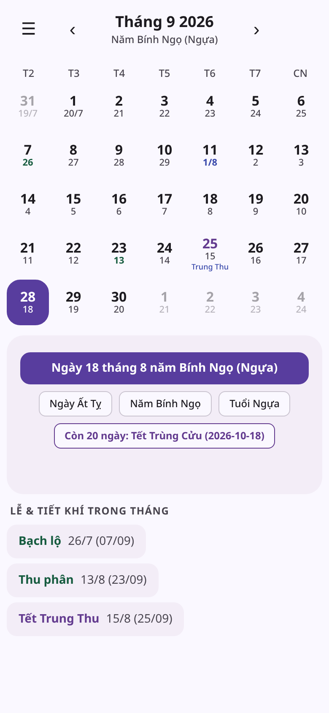
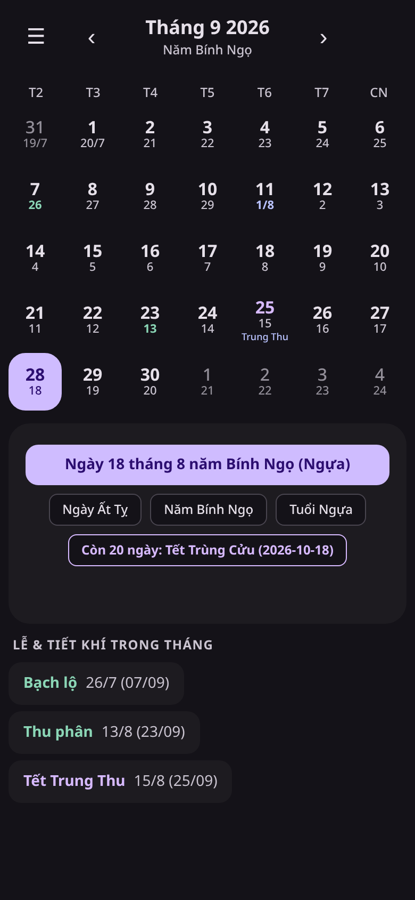
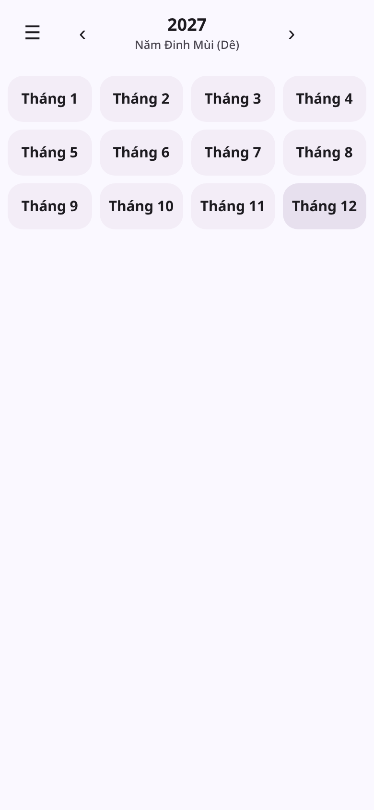
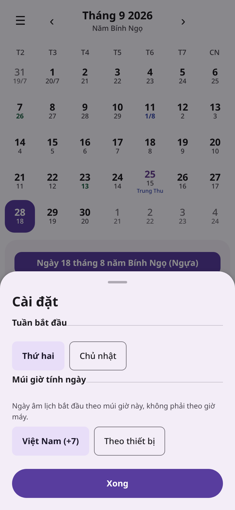
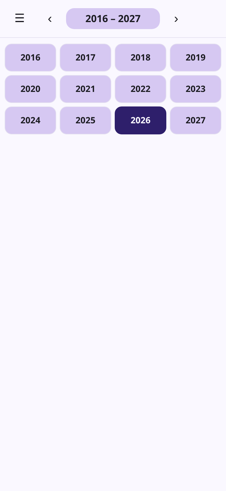
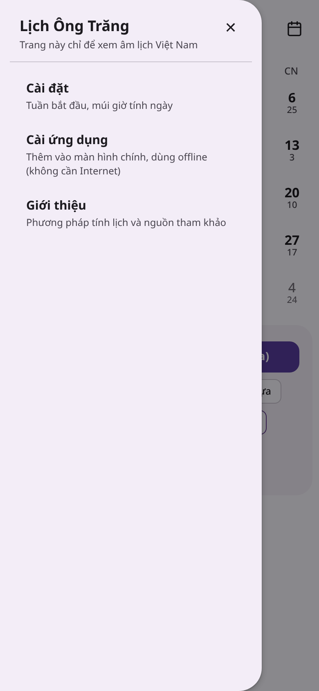
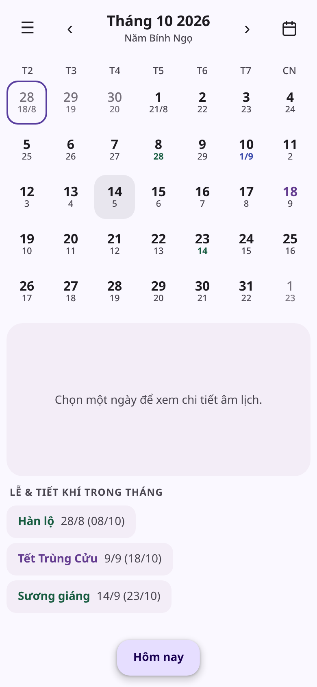
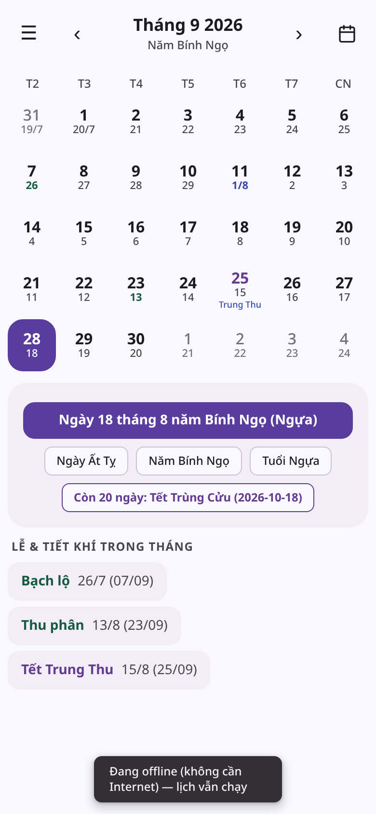
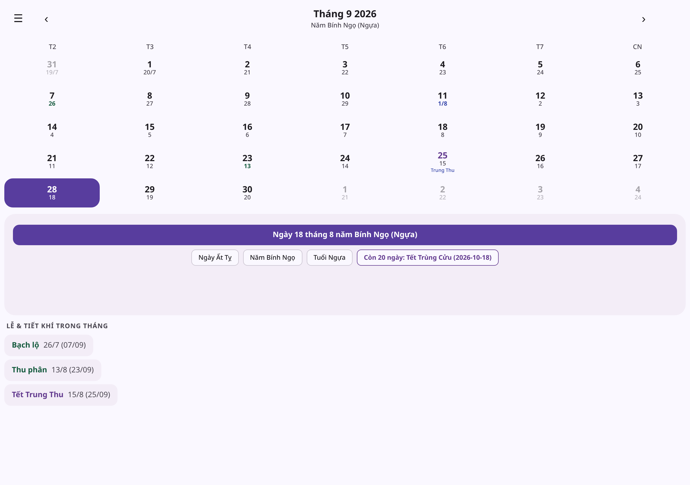

# Lịch Ông Trăng — Web

An offline-first Progressive Web App (PWA) for the Vietnamese lunisolar calendar: the month laid out
with both solar and lunar dates, Can-Chi, 24 tiết khí (solar terms), Vietnamese holidays, and a day
detail panel — running in any modern browser and working with no network at all.

## Screenshots

| Light Theme | Dark Theme | 12-Month Selector | Settings Sheet |
| :---: | :---: | :---: | :---: |
|  |  |  |  |

| 12-Year Block | Navigation Drawer | Away from Today | Offline Mode |
| :---: | :---: | :---: | :---: |
|  |  |  |  |

<p align="center">
  
</p>

## Installing as an App (Offline PWA)

Lịch Ông Trăng can be installed directly onto your home screen or desktop so it launches in its own
window and works 100% offline without a network connection (also accessible in-app via **☰ → Cài ứng dụng**):

- **iPhone / iPad (Safari):** Open the site in Safari, tap the **Share** button, and select **Add to Home Screen** (*Thêm vào Màn hình chính*).
- **Android (Chrome):** Tap the **⋮** menu in the top-right corner and select **Install app** or **Add to Home screen** (*Cài đặt ứng dụng* / *Thêm vào Màn hình chính*).
- **Desktop (Chrome / Edge / Safari):** Click the **Install** icon in the address bar (or choose **File → Add to Dock** in Safari on macOS).

## Architecture & Stack

- **Zero Backend, 100% Static PWA:** There is no backend server, API, or runtime third-party library.
  All calendar calculations happen locally in the browser via [`src/engine/amlich.js`](src/engine/amlich.js),
  a clean ES module implementing Hồ Ngọc Đức's published Vietnamese lunisolar algorithm (Julian Day
  conversions, Jean Meeus's New Moon and solar longitude series, UTC+7 / device-zone lunar month and
  leap-month resolution, Can-Chi, 24 tiết khí, and Vietnamese solar/lunar holidays).
- **Vite Production Build (`vite.config.js`):** Bundles, tree-shakes, and minifies [`src/main.js`](src/main.js),
  [`src/engine/amlich.js`](src/engine/amlich.js), and [`src/styles.css`](src/styles.css) into
  content-hashed static assets (`dist/assets/index-[hash].js` ~8 KB gzipped,
  `dist/assets/index-[hash].css` ~2.8 KB gzipped). At the end of `vite build`, a lightweight build
  plugin writes `dist/build-info.json` and generates `dist/sw.js` from [`src/sw.template.js`](src/sw.template.js)
  with the exact list of emitted files and content hash.
- **Vitest (`tests/unit/`):** Runs fast unit tests, replays all **132** reference answers from the
  Android/JVM engine dump (`tests/unit/fixtures/engine-dump.json`), audits offline precache
  coverage across `dist/`, and executes `dist/sw.js` in an offline sandbox.
- **Playwright Test (`tests/e2e/`):** Runs end-to-end behavioral, layout, contrast, and offline
  checks across `chromium`, `firefox`, and `webkit`, and verifies pixel-for-pixel visual parity
  (`maxDiffPixels: 0`) against 11 golden screenshots in [`tests/e2e/__screenshots__/`](tests/e2e/__screenshots__/)
  using `await expect(page).toHaveScreenshot()`.

## Project Structure

```text
lichongtrang-web/
├── index.html                        # App shell entry point
├── package.json                      # Scripts & devDependencies (vite, vitest, @playwright/test)
├── vite.config.js                    # Vite bundler config + build-info.json & sw.js generator
├── playwright.config.js              # Playwright Test config (chromium, firefox, webkit)
├── public/                           # Static assets copied as-is to dist/
│   ├── LICENSE                       # AGPL-3.0 licence text served at /LICENSE
│   ├── manifest.webmanifest          # PWA install manifest
│   └── icons/                        # App and Apple touch icons
├── src/
│   ├── main.js                       # UI rendering, settings, keyboard, swipe, offline badge
│   ├── styles.css                    # Light/dark theme and responsive styles
│   ├── sw.template.js                # Service worker template (__VERSION__ & __PRECACHE__)
│   └── engine/
│       └── amlich.js                 # Hồ Ngọc Đức lunisolar calendar algorithm & UI models
├── tests/
│   ├── unit/
│   │   ├── fixtures/
│   │   │   └── engine-dump.json      # 132 reference answers from the Android/JVM engine
│   │   ├── amlich.test.js            # Calendar unit tests + 132-answer JVM corpus check
│   │   └── pwa-build.test.js         # Offline precache audit + service worker VM test
│   └── e2e/
│       ├── app.spec.js               # Playwright E2E & visual regression test suite
│       └── __screenshots__/          # 11 committed golden PNG baselines
├── docker/
│   └── nginx.conf                    # Nginx config (immutable /assets/ cache + PWA headers)
├── Dockerfile                        # Multi-stage build (node:22-bookworm-slim -> nginx:alpine)
└── Makefile                          # Convenience targets (check, verify-browser, docker-*)
```

## Developer Workflow

### 1. Install Dependencies

```sh
npm install
# or with Bun:
bun install
```

### 2. Local Development Server (with HMR)

```sh
npm run dev
```

Opens the Vite development server (default `http://localhost:5173`) with instant Hot Module
Replacement when editing files in `src/`.

### 3. Production Build & Local Preview

```sh
npm run build      # Bundles and minifies into dist/, generating build-info.json and sw.js
npm run preview    # Serves dist/ locally at http://localhost:4173 to test the production PWA
```

> **Note:** Service workers require HTTPS or `localhost` / `127.0.0.1`.

### 4. Running Tests

**Unit, 132-Answer JVM Reference Corpus, and Offline Build Tests (Vitest):**

```sh
npm test           # Single run (vitest run)
npm run test:watch # Interactive watch mode (vitest)
npm run check      # Runs vite build && vitest run
```

**End-to-End & Visual Regression Tests (Playwright Test):**

```sh
npm run test:e2e                        # Run in Chromium (includes all 11 visual snapshot checks)
npm run test:e2e:all                    # Run across Chromium, Firefox, and WebKit (requires npx playwright install)
npx playwright test --project=firefox   # Run behavioral/layout/offline checks in Firefox
npx playwright test --project=webkit    # Run behavioral/layout/offline checks in WebKit (Safari)
```

When you intentionally change UI styles or layout and want to update the 11 golden screenshots in
`tests/e2e/__screenshots__/`:

```sh
npm run test:e2e:update
```

## Moving Through the Calendar

- The `‹` and `›` buttons, `PageUp` / `PageDown`, or **swiping sideways on the grid** step a month.
- The arrow keys move the selected day by one day (`←` / `→`) or one week (`↑` / `↓`), crossing
  month boundaries automatically.
- **Tapping the month title zooms out:** first to a 12-year block (`2016 – 2027`), then to that
  year's 12 months. Picking a year opens its months, picking a month opens its grid, and `Escape`
  steps back out one level at a time.
- The `☰` button at the leading edge opens the navigation drawer with **Cài đặt** (week
  start, time zone) and **Giới thiệu** (algorithm credits, AGPL-3.0 licence, and the interactive
  build stamp).

## Deployment

### Option 1: Static Hosting

`dist/` produced by `npm run build` is 100% static files. Upload `dist/` to any HTTPS static host
(Cloudflare Pages, GitHub Pages, Netlify, Vercel, S3, or your own web server).

### Option 2: Docker & Homeserver Deployment

The repository includes a multi-stage [`Dockerfile`](Dockerfile) and [`docker/nginx.conf`](docker/nginx.conf):
1. **Build stage (`node:22-bookworm-slim`):** installs dependencies and runs `npm run check`
   (`vite build && vitest run`), ensuring no broken build or engine regression can ever produce an
   image.
2. **Runtime stage (`nginx:alpine`):** serves `/usr/share/nginx/html` with `Cache-Control: no-cache`
   on `/index.html`, `/sw.js`, and `/build-info.json`, and `Cache-Control: public, max-age=31536000, immutable`
   on Vite's content-hashed `/assets/*` bundles.

Build and run the Docker image directly:

```sh
docker build -t lichongtrang-web:latest .
docker run -d -p 8080:80 --name lichongtrang-web lichongtrang-web:latest
```

Or use the [`Makefile`](Makefile) shortcuts to build and publish to a container registry:

```sh
make docker-build                              # Builds lichongtrang-web:latest locally
make docker-publish IMAGE=registry/app:latest  # Builds and pushes to your registry
```

Then on the homeserver:

```sh
docker compose pull && docker compose up -d
```

## Licence

AGPL-3.0-only — see [`LICENSE`](LICENSE).
